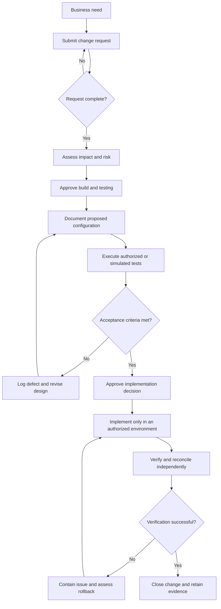

# Payroll Configuration Change Governance

A documentation-first framework for requesting, assessing, approving, testing, implementing, verifying, and auditing payroll configuration changes. The project uses a fictional organization and fictional data to demonstrate governance controls without representing a live Workday tenant.

> **Simulation notice:** Nothing in this repository proves that a setting was configured, tested, or deployed in Workday. All people, payroll records, approvals, evidence references, test outcomes, and defects are fictional or simulated unless an authorized organization replaces them with controlled evidence.

## Project overview

Payroll configuration changes can affect gross-to-net calculations, taxes, accounting, integrations, reporting, security, and employee experience. This repository brings the supporting governance artifacts into one traceable package.

The reference organization is **Northstar Services Group (NSG)**, a fictional United States professional-services company. The main scenario proposes a taxable home-office stipend and follows it from business request through impact review, approval, simulated testing, implementation decision, verification, audit logging, and closure.

The project objectives are to:

- Define a consistent payroll configuration change lifecycle.
- Document proposed earnings, deductions, pay groups, calendars, and tax-rule designs.
- Establish approval, access, segregation-of-duties, testing, rollback, and audit controls.
- Provide reusable templates, matrices, checklists, workbooks, and fictional sample data.
- Demonstrate traceability among requirements, configuration design, approvals, tests, defects, evidence, and closure.
- Clearly separate proposed documentation and simulated results from live Workday activity.

See the [project overview](docs/project-overview.md) for the full scope, stakeholders, assumptions, and fictional scenario.

## Scope

### Included

- Payroll configuration design documentation.
- Change intake, impact assessment, approval, implementation, verification, and rollback planning.
- Security roles, access boundaries, and segregation-of-duties controls.
- Test planning, test cases, payroll validation, defect tracking, and evidence requirements.
- Fictional CSV sample data and Excel-compatible governance workbooks.
- Management reporting, audit review, project outcomes, and release documentation.

### Not included

- Access to or modification of a Workday tenant.
- Production payroll processing, migration, or employee self-service activity.
- Real employee, payroll, banking, tax, credential, or personally identifiable information.
- Tenant-specific configuration instructions or proof of Workday functionality.
- Legal, tax, accounting, payroll, privacy, records-retention, or compliance advice.

## Governance workflow



The diagram represents the proposed lifecycle. It is not an implemented Workday business process. See the detailed [process flow](business-processes/process-flow.md), [business-process framework](docs/business-process-framework.md), and [change-governance procedure](docs/change-governance-procedure.md).

## Completed deliverables

| Area | Deliverables |
| --- | --- |
| Project documentation | [Project overview](docs/project-overview.md), [payroll configuration guide](docs/payroll-configuration-guide.md), [business-process framework](docs/business-process-framework.md), [security overview](docs/security-roles-and-access.md), and [change-governance procedure](docs/change-governance-procedure.md) |
| Configuration | [Earnings](configuration/earnings-configuration.md), [deductions](configuration/deductions-configuration.md), [pay groups](configuration/pay-groups-configuration.md), [payroll calendars](configuration/payroll-calendars.md), and [tax rules](configuration/tax-rules-configuration.md) |
| Change management | [Change request template](change-management/change-request-template.md), [fictional completed request](change-management/example-change-request-pcr-2027-001.md), [approval workflow](change-management/change-approval-workflow.md), [impact assessment](change-management/change-impact-assessment.md), [rollback procedure](change-management/rollback-procedure.md), and [change log](change-management/change-log.xlsx) |
| Business processes | [Payroll change process](business-processes/payroll-change-process.md), [process flow](business-processes/process-flow.md), and [approval matrix](business-processes/approval-matrix.xlsx) |
| Security | [Access-control guidance](security/access-control-guidelines.md), [segregation-of-duties guidance](security/segregation-of-duties.md), and [role-permission matrix](security/role-permission-matrix.xlsx) |
| Validation | [Test plan](validation-testing/test-plan.md), [24 test cases](validation-testing/test-cases.xlsx), [payroll validation checklist](validation-testing/payroll-validation-checklist.md), and [defect tracker](validation-testing/defect-tracking.xlsx) |
| Sample data | [Fictional earnings](sample-data/sample-earnings.csv), [deductions](sample-data/sample-deductions.csv), and [payroll calendars](sample-data/sample-payroll-calendar.csv) |
| Reporting | [Change summary](reports/change-summary-template.xlsx), [payroll audit checklist](reports/payroll-audit-checklist.md), and [project outcomes and metrics](reports/project-outcomes.md) |
| Release | [Draft v1.0.0 release notes](RELEASE_NOTES.md) and [screenshot evidence guidance](screenshots/README.md) |

## Repository map

```text
payroll-configuration-change-governance/
|-- README.md
|-- RELEASE_NOTES.md
|-- docs/                  # Overview, payroll, process, security, and governance documents
|-- configuration/         # Proposed configuration specifications
|-- change-management/     # Request, approval, impact, rollback, and change-log artifacts
|-- business-processes/    # Workflow, process flow, and approval matrix
|-- security/              # Access controls, roles, and segregation of duties
|-- validation-testing/    # Test plan, cases, checklist, and defect tracker
|-- sample-data/           # Fictional CSV records only
|-- reports/               # Summary, audit, and outcomes artifacts
`-- screenshots/           # Sanitized screenshot guidance; no evidence images currently stored
```

## Tools and formats

- **Git and GitHub:** version control, review history, and release tagging.
- **Markdown and Mermaid:** governance documentation and process diagrams.
- **Microsoft Excel-compatible workbooks:** logs, approval and security matrices, test cases, defects, and summary reporting.
- **CSV:** fictional earning, deduction, and payroll-calendar records.
- **Workday Payroll terminology:** conceptual business context only; the project has no tenant connection.

## Usage instructions

1. Read the [project overview](docs/project-overview.md) and [change-governance procedure](docs/change-governance-procedure.md).
2. Copy the [change request template](change-management/change-request-template.md) and assign a unique `PCR-YYYY-NNN` identifier.
3. Complete the impact assessment and determine the required approvers, testing scope, security review, and rollback owner.
4. Update only the relevant proposed configuration document. Do not label an unverified setting as actual configuration.
5. Record tests, evidence references, defects, approvals, implementation decisions, verification, and closure using the same change ID.
6. Update the change log and summary report using fictional or authorized sanitized data only.
7. Run the repository checks below, obtain peer review, and commit through the approved version-control process.

Useful local checks:

```powershell
git status
git diff --check
git ls-files
git log --oneline --decorate -10
```

## Assumptions

- NSG and every named person, worker, approver, identifier, amount, and evidence reference are fictional.
- The sample scenario assumes a United States payroll with biweekly and semimonthly pay groups.
- Example taxability, overtime, priority, limit, and jurisdictional statements require qualified approval before operational use.
- Dates use `YYYY-MM-DD`, and cross-artifact change references use `PCR-YYYY-NNN`.
- Proposed role and approval matrices require validation against an authoritative organization roster and delegated authority.

## Limitations and live Workday distinction

This repository demonstrates documentation quality and control design. It does not establish that the controls operated effectively in production.

- `Proposed` means documented for review but not verified in an authorized tenant.
- `Simulated` means evaluated as a fictional walkthrough without authorized tenant execution.
- `Not Executed` means no test result is claimed.
- `Actual` or `Implemented` should be used for live activity only when authorized evidence supports the statement. Workbook examples may use implementation dates solely to demonstrate reporting logic and remain fictional.

The workbooks do not replace a governed system of record, electronic approval platform, evidence repository, access-review system, or jurisdiction-specific professional review.

## Quality review and release status

The Day 19 review validated the original 35-file package: 25 Markdown files, 6 Excel workbooks, 3 CSV datasets, and `.gitignore`. It found no remaining broken relative links, CSV validation errors, workbook formula errors, or repository-structure discrepancies after corrections.

Day 20 added this final README and the `v1.0.0` release notes. All 36 intended release files are tracked. The final documentation and confidentiality-pattern checks completed without errors, and the annotated `v1.0.0` tag was prepared locally. The final release commit and tag have not been pushed or published.

See [release notes](RELEASE_NOTES.md) and [project outcomes and metrics](reports/project-outcomes.md) for the release summary, measured results, limitations, and future enhancements.
