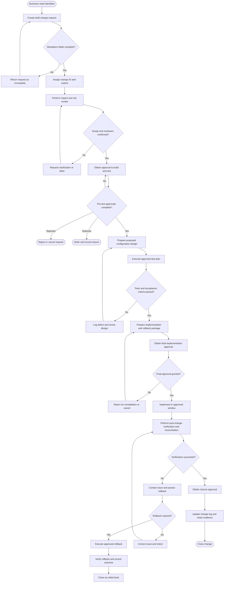

# Payroll Configuration Change Process Flow

This Mermaid diagram represents the proposed workflow defined in the [business process framework](../docs/business-process-framework.md) and [payroll change process](payroll-change-process.md). It does not represent an implemented Workday business process.

## Gate interpretation

| Decision | Required evidence |
| --- | --- |
| Mandatory fields complete | Completed request sections, assigned owner, requested date, impacted configuration, initial risk indicators, and acceptance criteria |
| Scope and reviewers confirmed | Impact assessment, risk rating, dependencies, required approvers, and rollback owner |
| Pre-test approvals complete | Explicit business, payroll, and control-owner decisions required by the risk rating |
| Tests passed | Approved test cases, expected and actual results, defect disposition, and test-owner sign-off |
| Final approval granted | Completed implementation plan, rollback plan, communication plan, successful test evidence, and authorized implementer |
| Verification successful | Post-change validation, reconciliation, exception resolution, and verifier sign-off |

## Related documents

- [Change request template](../change-management/change-request-template.md)
- [Change approval workflow](../change-management/change-approval-workflow.md)
- [Change governance procedure](../docs/change-governance-procedure.md)
- [Change impact assessment](../change-management/change-impact-assessment.md)
- [Rollback procedure](../change-management/rollback-procedure.md)
- [Test plan](../validation-testing/test-plan.md)
